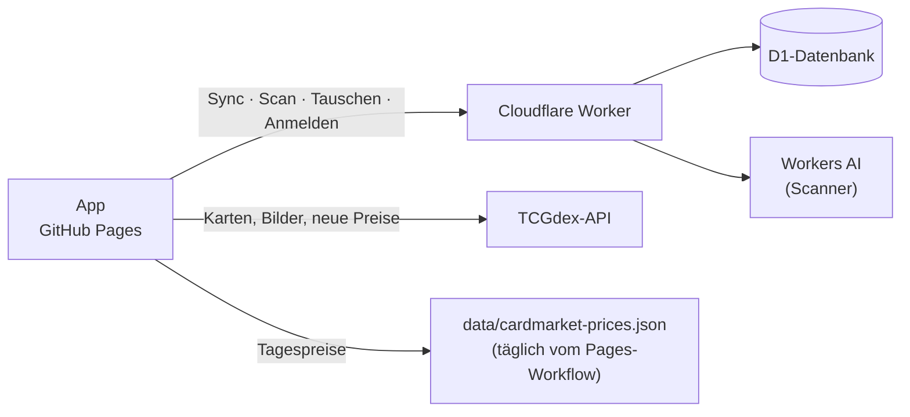
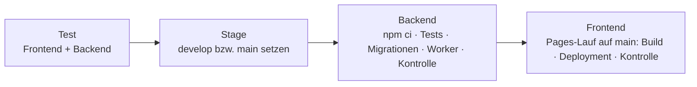

<div align="center">

# 🃏 Pokémon-Sammlung

**Deine Pokémon-Karten als iPhone-App** – suchen, scannen, sammeln, tauschen.<br>
Deutsch & Englisch · funktioniert offline · für mehrere Personen

**[pokekiste.app](https://pokekiste.app/)** · [Dev-Version](https://pokekiste.app/dev/)

[](https://github.com/KingBob4Real/pokemon-sammlung/actions/workflows/test.yml)
[](https://github.com/KingBob4Real/pokemon-sammlung/actions/workflows/pages.yml)
[](https://github.com/KingBob4Real/pokemon-sammlung/actions/workflows/backend.yml)

</div>

Web-App ohne Build-Schritt auf GitHub Pages, dazu ein kleines Cloudflare-Backend (Worker + D1-Datenbank + Workers AI), das die Sammlungen zwischen Geräten abgleicht. Kartendaten, Bilder und Preise kommen von [TCGdex](https://tcgdex.dev) und aus Cardmarkets öffentlicher Preisliste. Recherche und Messwerte hinter den Entscheidungen: [docs/NOTIZEN.md](docs/NOTIZEN.md).

## Inhalt

- [📱 Was die App kann](#-was-die-app-kann)
- [🔧 Entwicklung](#-entwicklung) – Aufbau, lokal starten, Tests, erweitern
- [🚀 Veröffentlichen](#-veröffentlichen) – Live & Dev, Versionen, Deploy mit einem Klick
- [💾 Backend & Daten](#-backend--daten) – Datenbank, Sync, Personen, Sicherheit, Speicher
- [🧰 Einrichtung (einmalig)](#-einrichtung-einmalig)

## 📱 Was die App kann

| | Bereich | Was geht |
| :---: | --- | --- |
| 🔍 | **Suche** | Alle deutschen und englischen Karten – nach Name, Nummer oder Set-Kürzel wie auf der Karte (`MEW 199`), Set für Set mit Fortschritt |
| 📚 | **Sammlung** | Anzahl, Zustand, Sprache, Kaufpreis – auch je Exemplar –, Ordner, eigene Reihenfolge, Schnellfilter |
| 📋 | **Listen** | Beliebig viele Wunschlisten, sortieren, umordnen, teilen |
| 📷 | **Scannen** | Karte fotografieren → erkannt → in der Sammlung. Auch Serien und ganze Ordnerseiten |
| 🔁 | **Tauschen** | Tauschrechner mit Cardmarket-Werten, dazu: wer hat doppelt, was dir fehlt |
| 💶 | **Marktwert** | Cardmarket Ø 7 Tage, Wertverlauf, Gestiegen & Gefallen |
| 👤 | **Wer sammelt?** | Profile wie bei Netflix, Abmelden auf fremden Geräten |
| 📱 | **App** | Vom Home-Bildschirm, offline, Updates von selbst, Holo-Karten zum Neigen |

### Suche & Sets

- Suchen nach Name (`Glurak` oder `Charizard`), Nummer (`199`, `199/165`), Set-Kürzel und Nummer wie auf der Karte (`MEW 199`, `BS 11`, `30C 158`) oder Set-Namen – ab 2 Zeichen oder mit einer Nummer.
- Deutsch vor Englisch; Sets, die es nur auf Englisch gibt, sind markiert, TCG Pocket ist ausgeblendet. Karten, die TCGdex nur auf Englisch hat, findet auch der deutsche Name; Nachdrucke („Klassische Sammlung“, „Celebrations“) findet die Nummer auf der Karte.
- **Set-Ansicht:** sortieren nach Nummer oder Wert, filtern Alle · Fehlend · Vorhanden, „Fehlende als Liste anlegen“.
- **Meine Sets:** Ohne Eingabe zeigt die Suche jedes Set, aus dem du etwas hast, mit Fortschritt; darunter alle Sets.
- Lädt ein Kartenbild nicht, probiert die App weitere Quellen; ganz ohne Bild sind noch ~55 Karten.

### Sammlung & Ordner

- Oben Anzahl, Marktwert, Bezahlt und Gewinn/Verlust, dazu „+ Karten hinzufügen“ und „Scannen“.
- Pro Karte Anzahl, Zustand, Sprache, Kaufpreis, Ordner und Tauschen. Ab 2 Stück lässt sich jedes Exemplar einzeln erfassen (z. B. eins auf Deutsch für 120 €, eins auf Englisch).
- **Ordner** sind eigene Seiten mit Kennzahlen, Filter und Sortierung; Löschen lässt die Karten in der Sammlung. (Im Code und in der Datenbank heißen sie `section`.)
- Sortieren nach zuletzt hinzugefügt, eigener Reihenfolge (gedrückt halten und ziehen), Set & Nummer, Pokédex, Wert, Name; gruppieren nach Ordner, Set oder Liste. Schnellfilter Alle · Doppelte · Ohne Kaufpreis · Ohne Preis – die Kennzahlen gelten dann für genau diese Karten.
- In der Kartenansicht wischen oder ‹ › blättert in der gerade sichtbaren Reihenfolge.
- **Auswählen** (Sammlung, Liste, Suche): viele Karten auf einmal in Ordner, Listen oder die Sammlung, entfernen, Tauschen festlegen. Löschen hat „Rückgängig“ und fragt ab 10 Karten vorher nach.

### Listen

- Beliebig viele, umbenennen, sortieren und per Ziehen umordnen – die Listen und die Karten darin. Oben Fortschritt und der Wert der vorhandenen und der fehlenden Karten.
- Der Pokéball auf einer Kachel zeigt den Stand (rot-weiß = in der Sammlung); Antippen startet die Auswahl.
- „Teilen“ schickt die sichtbaren Karten als Text („Glurak 004/102 · Grundset“), z. B. nur die fehlenden für die Kartenbörse.

### Scannen

„📷 Scannen“ in der Sammlung, bei „+ Karten hinzufügen“ und im Tauschrechner. Workers AI liest Name, Nummer und Set-Kürzel, die App sucht die Karte im Katalog.

| Art | So geht's |
| --- | --- |
| **Einzeln** | Karte in den Rahmen, auslösen → Karte mit Preis, Anzahl, Zustand, Sprache, Kaufpreis → „In Sammlung“. Nichts erkannt: Suche, vorausgefüllt mit dem Gelesenen. |
| **Serie** | Kamera bleibt offen, eine Karte nach der anderen; mit „Auto“ löst sie selbst aus, sobald eine neue Karte ruhig im Rahmen liegt. |
| **Seite** | Ganze Ordnerseite fotografieren (3 × 3, 2 × 2, 3 × 4, 4 × 3), jedes Fach wird einzeln gelesen, leere fallen weg. Auch aus der Mediathek. |

- Serie und Seite sammeln in einer Liste; Unsicheres (gelb) vor dem Speichern klären, dann Zustand, Sprache, Ordner und Liste für alle wählen.
- **Tageslimit:** 360 Scans pro Person, 900 für alle zusammen auf Live, 60 auf Dev – der Gratis-Tarif von Workers AI ([Rechnung](docs/NOTIZEN.md#warum-ein-tageslimit--die-rechnung)).
- Das Foto geht nur zur Erkennung an Cloudflare Workers AI und wird nirgends gespeichert. Scannen braucht Internet und eine Anmeldung.

### Tauschen

- **Tauschrechner** – auch mit Leuten ohne App: „Ich gebe“ und „Ich bekomme“, Karten aus dem Katalog oder per Scan, pro Karte Cardmarket ab · Ø 1 · Ø 7 · Ø 30 Tage, Summen und Differenz. Sprache und Zustand stellen den Cardmarket-Link ein, den echten Preis dort als „Eigener Preis“ eintragen. Bleibt auf dem Gerät, bis du „Leeren“ tippst; gebucht wird nichts.
- **Was du anbietest:** pro Karte *Wenn doppelt* (Standard), *Ja, anbieten* oder *Nein, behalten*.
- **Mit den anderen:** pro Person „Tim bietet an, was dir fehlt“ und „Du bietest an, was Tim fehlt“ (alle Listen zählen als Wunschliste), „Im Rechner durchrechnen“. Braucht Internet.

### Marktwert & Wertverlauf

- **Marktwert = Cardmarket-Durchschnitt der letzten 7 Tage** (sonst 30 Tage) über alle Sprachen und Zustände – ein Richtwert. Den echten Preis für deine Sprache ab Excellent zeigt der Cardmarket-Link in der Kartenansicht. Genauer geht es kostenlos nicht ([warum](docs/NOTIZEN.md#warum-keine-sammel-abfrage-warum-kein-ab-nach-sprache-und-zustand)).
- Preise kommen täglich aus Cardmarkets Preisliste neben der App; nur eine neue Karte fragt einmal TCGdex.
- **Wertverlauf:** Änderung seit 7 und 30 Tagen, Gestiegen & Gefallen, Kurve des Sammlungswerts (neue Karten erhöhen ihn auch). Pro Person und Gerät, nicht synchronisiert.

### Wer sammelt?

- Profilauswahl wie bei Netflix: antippen meldet an, ohne Passwort.
- Jede Person hat auf dem Gerät eigene Daten. Unter „Mehr“: Namen ändern und „Abmelden“ (löscht die Daten der Person vom Gerät, im Backend bleibt alles).

### Offline, Updates & Sicherung

- iPhone: Safari → Teilen → „Zum Home-Bildschirm“.
- Offline gehen App, gesehene Kartenbilder, Abhaken, Listen und Ordner; synchronisiert wird später.
- Updates kommen von selbst beim Öffnen und bei jeder Rückkehr in die App (höchstens einmal pro Minute).
- Fehler erscheinen als Hinweise unten; der Sync versucht es selbst erneut (10 s → 5 min).
- **Sicherung:** „Mehr“ → Export/Import (JSON). Import nimmt auch die Export-Datei der alten Checkliste.

## 🔧 Entwicklung

### Aufbau



```
frontend/                      App für GitHub Pages (ES-Module, kein Build-Schritt)
  js/main.js                   Composition Root: erzeugt und verbindet alle Teile
  js/config.js                 feste Einstellungen
  js/core/                     Werkzeuge: DOM, Formatieren, Speicher, HTTP, Dateien
  js/data/                     Zugriff auf externe APIs: TCGdex, Cardmarket-Liste, eigenes Backend
  js/domain/                   reine Fachlogik: Karte, Preis, Sortierung, Scan-Zuordnung, Tauschen
  js/services/                 Anwendungslogik: Speicher, Sammlung, Listen, Preise, Sync, Scanner, Personen …
  js/ui/                       App-Hülle, Router, Komponenten, Ansichten
  test/                        Tests ohne Netz
backend/                       Cloudflare Worker + D1-Datenbank
  src/                         http/ → controllers/ → services/ → repositories/ (SQL pro Tabelle), validation/
  migrations/                  Datenbank-Schema
  scripts/                     Personen anlegen, Listen der alten Checkliste übernehmen
  test/                        Tests ohne Netz + smoke.mjs gegen ein laufendes Backend
scripts/cardmarket.mjs         Cardmarket-Zuordnung und tägliche Preisliste
docs/                          Notizen und Prompts
.github/workflows/             test.yml · backend.yml · pages.yml · deploy.yml
```

### Lokal starten

```bash
# Backend (Ordner backend/): lokale Datenbank, zwei Test-Personen, Worker auf :8787
npm run db:migrate:local
node scripts/add-user.mjs "Test A" --local
node scripts/add-user.mjs "Test B" --local
npm run dev

# Frontend (Ordner frontend/): auf localhost spricht die App automatisch mit http://127.0.0.1:8787
python -m http.server 5173
```

Nach Änderungen an JS/CSS hält der Service Worker lokal die alten Dateien (`?v=` ändert sich lokal nicht): in den Entwicklertools den Service Worker abmelden oder „Update on reload“ anhaken.

### Tests

| Was | Befehl | Wann automatisch |
| --- | --- | --- |
| Frontend: Katalog, Sammlung, Speicher & Preise, Personen, Scanner, Abgleich zwischen Geräten | `node frontend/test/<catalog\|collection\|memory\|profiles\|scan\|sync>.test.mjs` | jeder Push (`test.yml`), vor jedem Pages-Deploy |
| Backend: Sicherheit, Exemplare, Abgleich (echte SQL auf SQLite) | `node backend/test/<security\|copies\|sync>.test.mjs` | jeder Push, vor jedem Backend-Deploy |
| Smoke gegen ein laufendes Backend | `node backend/test/smoke.mjs <URL> <Schlüssel> [Schlüssel B]` | von Hand nach einem Deploy |

Der Smoke-Test prüft Sync, Trennung zwischen Personen, Tauschen, Exemplare, Scan und Bilder. Mit `SMOKE_ACCOUNTS=1` auch Anmelden, Abmelden und Name ändern. Gegen Live nur mit dem eigenen Schlüssel.

### Erweitern

- **Neue Ansicht** → Datei in `ui/views/` und in `ui/app.js` eintragen.
- **Neue Datenart** → Repository in `backend/src/repositories/`, Regel in `validation/changeValidator.js`, Eintrag in `backend/src/index.js` und `ENTITY_TYPES` im Frontend – die Sync-Logik bleibt unverändert.
- **Neue Datenquelle** → in der Content-Security-Policy in `index.html` unter `connect-src` eintragen, sonst blockiert der Browser sie.

## 🚀 Veröffentlichen

### Live & Dev

| Stage | Branch | App | Backend + Datenbank |
| --- | --- | --- | --- |
| **Live** (Prod) | `main` | <https://pokekiste.app/> | `pokemon-sammlung` |
| **Dev** | `develop` | <https://pokekiste.app/dev/> (grauer Kopf, „· DEV“) | `pokemon-sammlung-dev` |

Die Dev-App hat eigene Daten – Testen dort berührt die echte Sammlung nie. Echte Daten zum Testen: in der Live-App exportieren, in der Dev-App importieren.

**Ablauf:** pro Feature ein Branch von `main` (`feature/<name>`) → auf Dev testen → was raus soll, in einen Release-Branch (`release/<version>`, Version dort hochzählen) → auf Dev prüfen → live. Backend immer vor dem Frontend, damit neue Datenbank-Spalten da sind, bevor die App sie schickt.

### Versionen

Die Version steht in `frontend/js/config.js` (`APP_VERSION`) und unter „Mehr“ in der App. Hochgezählt wird im Release-Branch:

| Was kommt raus | Neue Version | Beispiel |
| --- | --- | --- |
| Fix | hinten +1 | 0.0.1 → 0.0.2 |
| Feature | Mitte +1, hinten 0 | 0.0.2 → 0.1.0 |
| etwas richtig Großes | vorne +1, Rest 0 | 0.4.3 → 1.0.0 |

Das technische `?v=` in `index.html` ist davon unabhängig und wird automatisch gesetzt (siehe unten).

### Deploy mit einem Klick

**Actions → „Deploy“ → Run workflow:** bei „Use workflow from“ den **Branch** wählen – z. B. `feature/xyz`, um ein einzelnes Feature auf Dev zu testen –, darunter die **Stage**.



| Stage | Was mit dem Branch passiert | Ziel |
| --- | --- | --- |
| `dev` | `develop` wird auf den Branch gesetzt (bricht ab, wenn dort Commits liegen, die es sonst nirgends gibt) | Dev-Backend + pokekiste.app/dev/ |
| `prod` | Branch wird in `main` gemergt („Release 0.1.0: &lt;Branch&gt;“) – nur, wenn er `main` schon enthält | Live-Backend + pokekiste.app |

- Deployt wird, was auf GitHub liegt: vorher pushen. Immer nur ein Deploy auf einmal; jeder Lauf schreibt eine Zusammenfassung.
- `develop`/`main` wandern mit, weil die Seite jeden Tag neu aus `main` (`/`) und `develop` (`/dev/`) gebaut wird. GitHub Pages veröffentlicht nur Läufe von `main` – darum startet Deploy den Pages-Lauf auf `main` und wartet ihn ab.

### Workflows

| Workflow | Auslöser | Was er tut |
| --- | --- | --- |
| `test.yml` – **Tests** | jeder Push, jeder Branch | alle Tests ohne Netz |
| `backend.yml` – **Backend zu Cloudflare** | Push auf `main`/`develop` mit Änderungen in `backend/` | Token prüfen → `npm ci` → Tests → Migrationen → Worker → Kontrolle |
| `pages.yml` – **Frontend auf GitHub Pages** | Push auf `main`/`develop` mit Änderungen in `frontend/` oder `scripts/`, täglich 04:30 UTC | Build (`main` → `/`, `develop` → `/dev/`, Version, Cardmarket-Preisliste) → Deployment → Kontrolle |
| `deploy.yml` – **Deploy** | von Hand, beliebiger Branch | siehe oben |

- **Version `?v=`:** setzt der Pages-Workflow selbst (Zeitpunkt des letzten Commits in `frontend/`). Neue Version → der Service Worker wirft die gespeicherten App-Dateien weg. **Nicht von Hand hochzählen.**
- **Von Hand**, im Ordner `backend/`: `npx wrangler d1 migrations apply DB --remote [--env dev]`, dann `npx wrangler deploy [--env dev]`; vor einer Live-Migration `npx wrangler d1 time-travel info DB` notieren (Wiederherstellung bis 7 Tage zurück). Frontend auf Dev: `git push origin <branch>:develop`.

## 💾 Backend & Daten

### Datenbank & Sync

Cloudflare D1 (SQLite), Gratis-Tarif: 500 MB pro Datenbank, 7 Tage Wiederherstellung (Time Travel).

| Tabelle | Inhalt |
| --- | --- |
| `cards` | Kartendaten: Name, Nummer, Set, Bild – pro Person |
| `collection` | Sammlung: Anzahl, Zustand, Sprache, Kaufpreis, Ordner (`section`), eigene Reihenfolge (`position`), Tauschen (`trade`, leer = wenn doppelt), Exemplare (`copies`, leer = alle gleich) |
| `lists` · `list_items` | eigene Listen und welche Karte in welcher Liste |
| `sections` | Ordner der Sammlung |
| `users` · `sessions` | Personen (Hash des Schlüssels; `password_hash`, `failed_*` ungenutzt) und angemeldete Geräte |
| `scan_usage` | Scans pro Person und Tag (fürs Tageslimit) |

- Alles außer `users` gehört je einer Person (`user_id`). Jede Zeile hat `updated` (neueste Änderung gewinnt), `deleted` und `rev` (Server-Stand). Ein Gerät schickt `POST /sync` mit seinen Änderungen und seinem letzten Stand und bekommt alles Neue dieser Person zurück; gelesen werden nur geänderte Zeilen, denn D1 zählt gelesene Zeilen.
- **Uhr:** `updated` setzt das Gerät, aber nach der Uhr des Servers (jede Antwort hat `now`) – eine falsch gehende Handy-Uhr verliert so keine Änderungen.
- **Zusammenführen:** Wartet etwas auf dem Gerät, holt der Sync erst ab. Hat ein anderes Gerät denselben Eintrag inzwischen geändert, wird Feld für Feld zusammengeführt (nur hier geändert → von hier, nur dort → von dort, beides → die neuere Änderung; Anzahl, Exemplare, Zustand, Sprache und Kaufpreis nur gemeinsam).
- **Kartendaten** schickt jedes Gerät mit; sie gelten nur für die eigene Sammlung, keine (veraltete) App überschreibt fremde.

### Personen & Schlüssel

Schlüssel liegen nur lokal in `.keys/<id>.txt` (nicht in Git); in der Datenbank steht nur ihr Hash. Der Schlüssel ist der Notfall-Zugang („Mehr“ → „Erweitert“), angemeldet wird per Antippen. Neue Personen erscheinen automatisch in der Auswahl. Im Ordner `backend/` (für Dev jeweils `--env dev`):

```bash
npm run user:add -- "Max"                      # neue Person, Schlüssel in .keys/max.txt
npm run user:add -- "Max" --id max             # gleiche ID nochmal = neuer Schlüssel (alter ist ungültig, Daten bleiben)
npm run user:add -- "Max" --id max --key-file ../.keys/max.txt --env dev   # Person auf Dev, gleicher Schlüssel wie live
npm run user:list

node scripts/import-legacy-lists.mjs <backend-adresse> ../.keys/<id>.txt   # Listen der alten Checkliste für diese Person
```

### Sicherheit

- **Anmelden ohne Passwort:** „Wer sammelt?“ zeigt alle Namen öffentlich, `POST /login` mit der ID reicht – wer die App-Adresse kennt, kann jede Person antippen.
- **Sitzungen** laufen nicht ab; „Abmelden“ beendet die des eigenen Geräts.
- **Bilder:** Kartenbilder nimmt das Backend nur von `https://assets.tcgdex.net/` an (die anderen sehen deine Karten beim Tauschen). `GET /img` baut die Adresse selbst aus geprüften Teilen und reicht nur PNG/JPEG/WebP durch.
- **Frontend:** Content-Security-Policy in `index.html` – nur eigene Skripte, Verbindungen nur zu TCGdex, dem Backend (Live, Dev, lokal) und der alten Checkliste.

### Speicher auf dem Gerät

Safari gibt der Domain etwa 5 MB `localStorage` für alle Personen zusammen. Live und Dev trennen sich über den Namen (`ps.` bzw. `ps-dev.`). Gemessen am 10.10.2026:

| Schlüssel | Inhalt | Größe |
| --- | --- | --- |
| `ps.[<person>.]entities.v1` (+ `dirty`, `base`, `rev`) | Sammlung, Listen, Ordner einer Person | ~330 B je Sammlungs-Eintrag, ~300 B je Listen-Eintrag |
| `ps.prices.v4` | Preise, alle Personen (älter als 30 Tage fliegt raus) | ~150 B je Karte |
| `ps.sets.v4` · `ps.images.v1` | Set-Liste · welche Bildquelle klappt | ~23 KB · ~100 B je Karte mit Ersatzbild |
| `ps.[<person>.]trade.v1` · `history.v1` | Tauschrechner · Wertverlauf (2 Jahre) | wenige KB · ~33 KB |

Eng wird es erst bei mehreren tausend Karten pro Person; Messwerte und Entscheidungen: [Notizen](docs/NOTIZEN.md#speicher-messwerte-und-entscheidungen).

## 🧰 Einrichtung (einmalig)

<details>
<summary><b>Backend bei Cloudflare</b></summary>

Voraussetzung: kostenloses Cloudflare-Konto. Im Ordner `backend/`:

```bash
npm install
npx wrangler login
npx wrangler d1 create pokemon-sammlung        # ausgegebene database_id in wrangler.toml eintragen
npm run db:migrate
npm run deploy                                 # gibt die Backend-Adresse aus (…workers.dev)
npm run user:add -- "Dein Name" --id owner
node test/smoke.mjs https://<backend-adresse> "$(cat ../.keys/owner.txt)"
```

</details>

<details>
<summary><b>GitHub: Cloudflare-Token für automatisches Veröffentlichen</b></summary>

1. Cloudflare-Dashboard → Profil → **API Tokens → Create Token** → Vorlage **„Edit Cloudflare Workers“** → **Use template**.
2. Unter *Permissions* eine Zeile hinzufügen: **Account · D1 · Edit**.
3. *Account Resources*: dein Konto; *Zone Resources*: **All zones** → **Continue to summary → Create Token** → Token kopieren (wird nur einmal angezeigt).
4. GitHub → **Settings → Secrets and variables → Actions → New repository secret**: Name `CLOUDFLARE_API_TOKEN`, Wert = Token.
5. Testen: **Actions → „Backend zu Cloudflare“ → Run workflow**.

Ohne Secret läuft `backend.yml` durch, warnt nur und veröffentlicht nichts.

</details>

<details>
<summary><b>Domain pokekiste.app</b></summary>

Bei Cloudflare gekauft, DNS bei Cloudflare: `CNAME @` und `CNAME www` → `kingbob4real.github.io`, **nur DNS** (graue Wolke, sonst bekommt GitHub kein Zertifikat). In GitHub unter Settings → Pages als Custom domain eingetragen. Die alte github.io-Adresse leitet automatisch weiter.

</details>

---

<div align="center">
<sub>Kartenbilder & Daten: <a href="https://tcgdex.dev">TCGdex</a> · Preise: Cardmarket · Fan-Projekt ohne Verbindung zu Nintendo, Creatures, GAME FREAK, The Pokémon Company oder Cardmarket.</sub>
</div>
