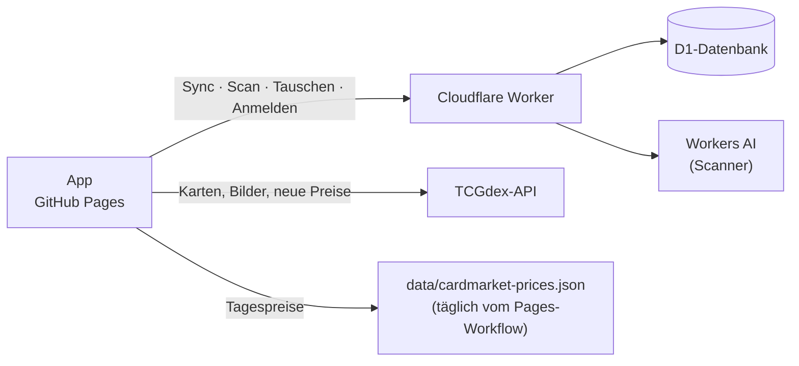
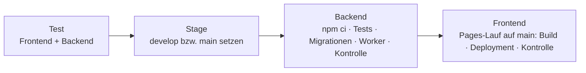

<div align="center">

# 🃏 Pokémon-Sammlung

**Deine Pokémon-Karten als iPhone-App** – suchen, scannen, sammeln, tauschen.<br>
Deutsch & Englisch · funktioniert offline · für mehrere Personen

**[pokekiste.app](https://pokekiste.app/)** · [Dev-Version](https://pokekiste.app/dev/)

[](https://github.com/KingBob4Real/pokemon-sammlung/actions/workflows/test.yml)
[](https://github.com/KingBob4Real/pokemon-sammlung/actions/workflows/pages.yml)
[](https://github.com/KingBob4Real/pokemon-sammlung/actions/workflows/backend.yml)

</div>

Web-App ohne Build-Schritt auf GitHub Pages, dazu ein kleines Cloudflare-Backend (Worker + D1-Datenbank + Workers AI), das die Sammlungen zwischen Geräten abgleicht. Kartendaten, Bilder und Preise kommen von [TCGdex](https://tcgdex.dev) und aus Cardmarkets öffentlicher Preisliste.

## Inhalt

- [✨ Auf einen Blick](#-auf-einen-blick)
- [📱 Funktionen](#-funktionen) – [Suche & Sets](#suche--sets) · [Sammlung & Ordner](#sammlung--ordner) · [Mehrere Karten auf einmal](#mehrere-karten-auf-einmal) · [Listen](#listen) · [Scannen](#scannen) · [Tauschen](#tauschen) · [Marktwert & Wertverlauf](#marktwert--wertverlauf) · [Wer sammelt?](#wer-sammelt) · [Bedienung, offline & Updates](#bedienung-offline--updates)
- [🔧 Entwicklung](#-entwicklung) – Aufbau, lokal starten, Tests, erweitern
- [🚀 Veröffentlichen](#-veröffentlichen) – Live & Dev, Versionen, Deploy mit einem Klick, Workflows
- [💾 Backend & Daten](#-backend--daten) – Datenbank, Personen, Sicherheit, Speicher
- [🧰 Einrichtung (einmalig)](#-einrichtung-einmalig)
- [🔬 Hintergrund & Notizen](#-hintergrund--notizen)

## ✨ Auf einen Blick

| | Bereich | Was geht |
| :---: | --- | --- |
| 🔍 | **Suche** | Alle deutschen und englischen Karten – nach Name, Nummer oder Set-Kürzel wie auf der Karte (`MEW 199`), Set für Set mit Fortschritt |
| 📚 | **Sammlung** | Anzahl, Zustand, Sprache, Kaufpreis – auch **je Exemplar** –, Ordner, eigene Reihenfolge, Schnellfilter |
| 📋 | **Listen** | Beliebig viele Wunschlisten, sortieren, umordnen, **teilen** |
| 📷 | **Scannen** | Karte fotografieren → erkannt → in der Sammlung. Auch Serien und ganze Ordnerseiten |
| 🔁 | **Tauschen** | Tauschrechner mit Cardmarket-Werten, dazu: wer hat doppelt, was dir fehlt |
| 💶 | **Marktwert** | Cardmarket Ø 7 Tage, Wertverlauf, Gestiegen & Gefallen |
| 👤 | **Wer sammelt?** | Profile wie bei Netflix, mit Passwort, Abmelden auf fremden Geräten |
| 📱 | **App** | Vom Home-Bildschirm, offline, Updates von selbst, Holo-Karten zum Neigen |

## 📱 Funktionen

### Suche & Sets

- **Suchen** über die [TCGdex-API](https://tcgdex.dev): nach Name (`Glurak` oder `Charizard`) und/oder Nummer (`199`, `199/165`), nach Set-Kürzel und Nummer wie auf der Karte (`MEW 199`, `BS 11`, `ASC 017`, `MEP 91`, `30C 158`) oder nach Set-Namen (`Erhabene Helden`, `Evolving Skies`). Die Suche startet ab 2 Zeichen oder mit einer Nummer (ein Buchstabe allein lädt bei TCGdex ~1,2 MB).
- **Deutsch vor Englisch:** Gibt es eine Karte in beiden Sprachen, gewinnt die deutsche. Sets, die es nur auf Englisch gibt (z. B. Gym Heroes, McDonald's), sind dabei und als „nur Englisch“ markiert. TCG-Pocket-Karten sind ausgeblendet.
- **Karten, die TCGdex nur auf Englisch hat** (z. B. viele MEP- und SVP-Promos) findet auch der deutsche Name – über die Pokédex-Nummer, angezeigt mit deutschem Namen („Mega-Dragoran-ex“). Wie das geht: [Hintergrund](#karten-nur-auf-englisch--nachdrucke).
- **Nachdrucke mit der Nummer des Originals** („30 Jahre: Klassische Sammlung“, „Celebrations: Klassische Kollektion“) findet man mit der Nummer auf der Karte: `106/106`, `30C 106/106`, `Glurak 4/102`, auch `CC12`.
- **Set für Set:** sortieren nach Nummer oder Wert (auf- oder absteigend; Nummern mit Buchstaben wie `TG01` oder Mew `B`/`G`/`R` stehen hinter den Zahlen), filtern **Alle · Fehlend · Vorhanden**. **„Fehlende als Liste anlegen“** legt eine Liste mit dem Set-Namen und allen fehlenden Karten an und öffnet sie – gibt es die Liste schon, kommen nur die noch nicht enthaltenen dazu.
- **Meine Sets:** Ohne Eingabe zeigt die Suche oben jedes Set, aus dem mindestens eine Karte in der Sammlung ist – Name, „12/165“ und Fortschrittsbalken, am weitesten zuerst; darunter „Sets durchstöbern“.
  - Gezählt wird offline aus der Sammlung, aus derselben Quelle wie „x von y“ in der Set-Ansicht (`collection.countBySet()`, `sets.info(id).total` = deutsche Karten plus die, die TCGdex nur auf Englisch hat, z. B. MEP 112 statt 80).
  - Bei Jumbo, MFB, SM-Trainer-Kit u. a. listet TCGdex weniger Karten, als das Set hat – gezählt wird das Set.
- **Kartenbilder:** Lädt eins nicht, probiert die App weitere Quellen (TCGdex deutsch → englisch → Limitless → TCGplayer → pokemontcg.io) und merkt sich, welche klappt. Ganz ohne Bild sind noch ~55 Karten. Details: [Kartenbilder](#kartenbilder-die-quellen-kette).

### Sammlung & Ordner

- **Oben:** Suchfeld und „Auswählen“, Kennzahlen (Anzahl, Marktwert, Bezahlt, Gewinn/Verlust), „+ Karten hinzufügen“ und „Scannen“.
- **Ordner** (z. B. „Ordner 1“, „Tauschkarten“) mit Name, Kartenzahl und Wert, dazu „Ohne Ordner“ und „+ Neuer Ordner“. Jeder Ordner ist eine eigene Seite (`#ordner/<id>`, `#ordner/ohne`) mit Kennzahlen, Filter, Sortieren, Gruppieren, Auswählen, „Umbenennen“ und „Löschen“ (die Karten bleiben in der Sammlung, nur ohne Ordner).
- **Pro Karte:** Anzahl, Zustand, Sprache, Kaufpreis, Ordner und Tauschen. „Aus der Sammlung entfernen“ in der Kartenansicht.
- **🃏 Exemplare einzeln:** Ab 2 Stück lässt sich unter „Exemplare einzeln erfassen“ jedes Exemplar mit eigener Sprache, eigenem Zustand und Kaufpreis eintragen (z. B. eins auf Deutsch für 120 €, eins auf Englisch); „ד nimmt genau dieses heraus.
  - Bezahlt, Gewinn/Verlust und „Ohne Kaufpreis“ rechnen dann pro Exemplar.
  - Scannen legt neue Exemplare mit den Angaben vom Scan an (gescannte englische Karte = englisches Exemplar), statt die vorhandenen zu überschreiben.
  - Sind alle wieder gleich, speichert die App nur die Anzahl. Gespeichert in `copies` (nur, wenn sie sich unterscheiden; höchstens 100); Zustand/Sprache/Kaufpreis der Karte = erstes Exemplar – das nutzen Tauschen und der Cardmarket-Link.
- **Sortieren** nach zuletzt hinzugefügt, **eigener Reihenfolge** (gedrückt halten und ziehen), Set & Nummer, Pokédex, Wert, Name; **gruppieren** nach Ordner, Set oder Liste.
- **Schnellfilter** unter dem Suchfeld: **Alle · Doppelte · Ohne Kaufpreis · Ohne Preis**. Wirkt mit dem Textfilter zusammen, bleibt beim Wechseln der Ansicht erhalten, und die Kennzahlen gelten dann für genau diese Karten („Doppelte: 132 Karten, 651 €“).
- **Blättern:** In der Kartenansicht nach links/rechts wischen, ‹ › neben dem Bild oder Pfeiltasten → vorige/nächste Karte, in der gerade sichtbaren Reihenfolge (Filter, Sortierung, Gruppen; `openCard` in `ui/app.js` nimmt die sichtbaren Kacheln). Nur deutlich waagerechtes Wischen zählt, Scrollen bleibt.

> Ordner heißen im Code und in der Datenbank weiterhin `section` (Tabelle `sections`) – früher „Abteilungen“, die Daten sind dieselben.

### Mehrere Karten auf einmal

In Sammlung, Liste und Suche: **„Auswählen“**, Karten antippen (in der Suche auch über mehrere Suchen hinweg), unten „Alle“ und ein Menü.

| Wo | Was geht |
| --- | --- |
| Suche, Set, Liste | zur Sammlung, zu einer Liste, „Neue Liste …“, „Aus der Sammlung nehmen“ |
| Sammlung | „In Ordner …“ (jeder Ordner, „+ Neuer Ordner …“, „Aus dem Ordner nehmen“, Listen), „Entfernen“, Tauschen für viele Karten |
| Ordner | „Aus dem Ordner nehmen“ (bleibt in der Sammlung) und „Aus der Sammlung löschen“ |
| Liste | „Hab ich“ (in die Sammlung) und „Entfernen“ (aus der Liste) |

Löschen hat **„Rückgängig“** (holt Zustand, Kaufpreis und Ordner zurück) und fragt ab 10 Karten vorher nach. „+ Karten hinzufügen“: suchen oder Set öffnen und Karten einfach antippen.

### Listen

- Beliebig viele, umbenennen, löschen, sortieren (Dropdown) und per Gedrückt-halten-und-ziehen umordnen – die Listen selbst und die Karten darin.
- Karten sortieren nach eigener Reihenfolge, Pokédex (hält Entwicklungsreihen zusammen), Set & Nummer, Name, Wert; filtern **Alle · Fehlend · Vorhanden**. Oben Fortschritt und der Wert der vorhandenen und der fehlenden Karten.
- **Der Pokéball** oben rechts auf einer Kachel zeigt den Stand (rot-weiß = in der Sammlung, Umriss = fehlt). Antippen **startet die Auswahl** mit dieser Karte (in Suche, Set und Liste) – weitere antippen, dann unten entscheiden. Danach wackeln die frisch gefangenen Pokébälle kurz.
- **„Teilen“** schickt die gerade sichtbaren Karten als Text („Glurak 004/102 · Grundset“) übers Teilen-Menü – mit Filter „Fehlend“ z. B. für die Kartenbörse oder Leute ohne App. Wo es kein Teilen-Menü gibt, landen sie in der Zwischenablage.

### Scannen

„📷 Scannen“ in der Sammlung, bei „+ Karten hinzufügen“ und im Tauschrechner öffnet die Kamera. Das Foto liest Workers AI (Name, Nummer, Setgröße, Set-Kürzel), die App sucht die passende Karte im Katalog.

| Art | So geht's |
| --- | --- |
| **Einzeln** | Karte in den Rahmen, auslösen → Karte mit Preis, Anzahl, Zustand, Sprache, Kaufpreis („Preis übernehmen“ = Marktwert) und Listen → „In Sammlung“ bzw. „Anzahl erhöhen“ → „Nächste Karte scannen“. Mehrere passen: Auswahl. Nichts erkannt: Suche, vorausgefüllt mit dem Gelesenen. |
| **Serie** | Kamera bleibt offen, eine Karte nach der anderen. Mit **„Auto“** löst sie selbst aus, sobald eine neue Karte ~0,7 s ruhig im Rahmen liegt. Kurzes Blitzen als Rückmeldung. |
| **Seite** | Ganze Ordnerseite fotografieren, Layout wählen (3 × 3, 2 × 2, 3 × 4, 4 × 3), auf die Linien ausrichten – jedes Fach wird einzeln gelesen, leere fallen weg. „Foto wählen“ nimmt ein Foto aus der Mediathek. |

- **Liste & Speichern** (Serie und Seite): Erkanntes landet in einer Liste (Bild, Name, Nummer, Preis, Anzahl ±), unsichere Karten sind gelb. „Fertig“ → Unsicheres per „Wählen“/„Suchen“ klären (mit Foto-Ausschnitt), Zustand, Sprache, Ordner und Liste für alle wählen → „12 Karten in die Sammlung“. Die Liste bleibt bis zum Speichern erhalten.
- **Tageslimit:** 360 Scans pro Person, 900 für alle zusammen auf Live, 60 auf Dev. Unter dem Auslöser steht „Noch 43 Scans heute“. Warum es ein Limit gibt: [Scanner im Detail](#scanner-im-detail).
- **Datenschutz:** Das Foto geht nur zur Erkennung an Cloudflare Workers AI und wird nirgends gespeichert – weder auf dem Gerät noch in der Datenbank.
- Scannen braucht Internet und eine Anmeldung (das Backend zählt pro Person).

### Tauschen

Eigener Reiter **„Tauschen“** unten (`#tauschen`).

**Tauschrechner** – mit jedem, auch mit Leuten ohne App:
- „Ich gebe“ und „Ich bekomme“, über „+ Karte“ beliebige Karten aus dem Katalog oder mit „📷 Scannen“ (auch Serie und ganze Seite; jede Seite hat ihre eigene Scan-Liste, getrennt von der Sammlung), Anzahl ±.
- Pro Karte die Cardmarket-Werte **ab · Ø 1 Tag · Ø 7 Tage · Ø 30 Tage**, unten je Wert die Summen beider Seiten und die **Differenz** (bekommen − geben).
- Sprache und Zustand pro Karte stellen den Cardmarket-Link ein (z. B. Englisch, ab Mint); den echten Preis dort nachsehen und als **„Eigener Preis“** eintragen – der zählt dann in allen Zeilen. Was du gibst, startet mit Sprache und Zustand aus deiner Sammlung.
- Bleibt pro Person auf dem Gerät gespeichert (`trade.v1`), bis du „Leeren“ tippst. Gebucht wird nichts.

**Was du anbietest:** In der Kartenansicht unter „Tauschen“ – *Wenn doppelt* (Standard), *Ja, anbieten* (auch eine einzelne Karte) oder *Nein, behalten* (auch wenn doppelt); per „Auswählen“ auch für viele Karten auf einmal. „Was du anbietest“ zeigt, was die anderen von dir sehen.

**Mit den anderen:** Pro Person zwei Abschnitte mit Kacheln, je mit Anzahl und Marktwert (ein Exemplar je Karte), damit man sieht, ob der Tausch fair ist:
- **„Tim bietet an, was dir fehlt“** – was er anbietet und in einer deiner Listen steht, aber nicht in deiner Sammlung
- **„Du bietest an, was Tim fehlt“**
- darunter „Im Rechner durchrechnen“ (übernimmt beides, je ein Exemplar) und aufklappbar „Alles, was Tim anbietet“

<details>
<summary>Technik: <code>GET /trade</code> und Regeln</summary>

- `GET /trade` (nur angemeldet) → `{ people: [{ id, name, offers: [{ card, qty, cond, lang }], missing: [card] }] }` für jede andere Person. Angebote = `collection` mit `trade = 1` oder (`trade` leer und `qty > 1`); fehlend = Karten aus ihren Listen, die nicht in ihrer Sammlung sind. Gelöschte Zeilen und Listen zählen nicht. Nur lesen, keine eigene Tabelle (`CollectionRepository.offers`, `ListItemRepository.missing`, `services/tradeService.js`). Tauschen pro Karte steht in `collection.trade` (Migration `0007_trade.sql`; leer = wenn doppelt).
- Abgleich in der App per Karten-ID (`domain/trade.js`) – die Sprache zählt nicht. Alle Listen zählen als Wunschliste. Jeder pflegt seine Sammlung selbst.
- Alle angemeldeten Personen sehen Angebote und Listen der anderen, ohne Einstellung (die App ist nur für uns, Namen sind ohnehin öffentlich).
- Braucht Internet; offline ein Hinweis (mit dem letzten Stand, falls schon geladen). Die letzte Antwort bleibt nur im Speicher, nicht auf dem Gerät.
- Warum es kein „ab“ nach Sprache und Zustand gibt: [Preise](#preise-quellen-und-grenzen).

</details>

### Marktwert & Wertverlauf

- **Marktwert = Cardmarket-Durchschnitt der letzten 7 Tage** (sonst Ø 30 Tage; keine Verkäufe in 30 Tagen = „ohne Preis“). Er mischt alle Sprachen und Zustände. Trend und „ab“ zählen nicht ([warum](#preise-quellen-und-grenzen)).
- **Kartenansicht:** Ø 7 Tage und Ø 30 Tage, dazu der **Cardmarket-Link**, gefiltert auf die Sprache der Karte ab Excellent – dort steht der echte Preis für genau solche Karten.
- **Frisch, aber sparsam:** Eine neue Karte fragt einmal TCGdex (Seltenheit, Pokédex-Nummer, Cardmarket-Produkt). Danach kommt ihr Preis jeden Tag aus Cardmarkets Preisliste neben der App – eine Datei für alle Karten statt einer Anfrage pro Karte (gemessen: 2 statt 166 Anfragen).
- **Karten ohne Preis:** Bei Namen mit ♀, ♂, ◇, δ, ’ oder „-EX“ ordnet TCGdex oft kein Cardmarket-Produkt zu – dann hilft eine eigene Zuordnung ([Details](#preise-quellen-und-grenzen)). Wo auch das nichts findet, sagt die Kartenansicht es, und der Cardmarket-Link sucht mit bereinigtem Namen („Nidoran“). Mit Produkt, aber ohne Verkäufe steht „keine Verkäufe“.
- **📈 Wertverlauf:** Unter „Marktwert“ die Änderung seit 7 und 30 Tagen, darunter **Gestiegen & Gefallen** mit dem größten Gewinner und Verlierer. Antippen zeigt „Wert deiner Sammlung“ als Kurve – neue Karten erhöhen ihn auch, er ist kein Gewinn – und die 5 Karten mit dem größten Unterschied Ø 7 gegen Ø 30 Tage.
  - Einmal am Tag merkt die App Gesamtwert und Kartenzahl – erst, wenn jede Karte einen frischen Preis hat (sonst landen halbe Summen im Verlauf).
  - Pro Person nur auf diesem Gerät, höchstens 2 Jahre (`services/historyService.js`; nicht synchronisiert – jedes Gerät schreibt seinen eigenen).

### Wer sammelt?

- **Profilauswahl wie bei Netflix:** Alle Personen (Lukas, Lucas, Tim) sind auf jedem Gerät da. Antippen + Passwort meldet an – kein Sync-Schlüssel nötig. Wechsel über das Rund-Symbol oben rechts; das Passwort wird bei jedem Wechsel abgefragt.
- **Jede Person hat auf dem Gerät eigene Daten.**
- **Unter „Mehr“:** Namen ändern, Passwort ändern (nur mit dem alten; neues Passwort = alle anderen Geräte dieser Person abgemeldet) und **„Abmelden“** – beendet die Sitzung und löscht die Daten der Person von diesem Gerät, z. B. auf einem geliehenen Handy (im Backend bleibt alles).
- **Noch kein Passwort?** Einmal mit dem Sync-Schlüssel anmelden („Mehr“ → „Erweitert“) und eins festlegen.
- 5 falsche Versuche → 15 Minuten Pause.

### Bedienung, offline & Updates

- **📲 Als App:** iPhone: Safari → Teilen → „Zum Home-Bildschirm“.
- **Offline:** Der Service Worker speichert die App und alle einmal gesehenen Kartenbilder. Abhaken, Listen und Ordner gehen weiter, synchronisiert wird später.
- **Updates von selbst:** Die App prüft beim Öffnen und bei jeder Rückkehr (höchstens einmal pro Minute), ob es eine neue Version gibt, und lädt dann neu – auch als Home-Bildschirm-App.
- **Am Handy:**
  - Die Leiste unten schwebt als Glas-Kapsel über dem Inhalt; die Markierung gleitet mit Feder zum gewählten Reiter.
  - Die Kartenansicht ist ein **Bottom Sheet**: oben nach unten ziehen oder schnippen schließt sie. Beim Öffnen **fliegt das Kachelbild** hinein und beim Schließen zurück.
  - Die große Karte ist eine **Holo-Karte** – Lichtreflex und Regenbogenfolie folgen der Maus bzw. dem Neigen des Handys (am iPhone fragt das erste Antippen einmal nach „Bewegung und Ausrichtung“).
  - Der Pokéball tickt beim Antippen kurz (iOS 18+). Bei „Bewegung reduzieren“ fliegt und kippt nichts.
- **Rückfragen** (anlegen, umbenennen, löschen) in einem eigenen Dialog statt der Systemdialoge: Enter = OK, Escape oder Tipp daneben = Abbrechen, Löschen mit rotem Knopf.
- **Fehler** erscheinen als verständliche Hinweise unten statt Pop-ups:
  - Der Sync versucht es bei Netz- oder Server-Problemen automatisch erneut (10 s → 5 min) und zeigt „Offline“ an.
  - Einzelne abgelehnte Einträge hält er zurück, statt alles zu blockieren. Ein falscher Schlüssel leert nie das Gerät.
  - Kann das Gerät nicht speichern, bietet die App sofort einen Export an. Suche, Sets und Preise haben „Nochmal“.
- **Sicherung:** unter „Mehr“ alles als JSON exportieren und importieren. **Alte Checkliste übernehmen** unter „Mehr“ → „Erweitert“: Jede Gruppe wird eine Liste, abgehakte Karten kommen mit „Mein Preis“ als Kaufpreis in die Sammlung.

## 🔧 Entwicklung

### Aufbau



```
frontend/                      App für GitHub Pages (ES-Module, kein Build-Schritt)
  index.html, sw.js, manifest.webmanifest, icon.png, css/
  js/main.js                   Composition Root: erzeugt und verbindet alle Teile
  js/config.js                 feste Einstellungen
  js/core/                     Werkzeuge: DOM, Formatieren, Speicher, HTTP, Dateien
  js/data/                     Zugriff auf externe APIs: TCGdex, Cardmarket-Liste, eigenes Backend
  js/domain/                   reine Fachlogik: Karte, Preis, Sortierung, Scan-Zuordnung, Tauschen
  js/services/                 Anwendungslogik: Speicher, Sammlung, Listen, Preise, Sets, Katalog, Sync, Scanner, Personen …
  js/ui/                       App-Hülle, Router, Komponenten, Ansichten
  test/                        Tests ohne Netz
backend/                       Cloudflare Worker + D1-Datenbank
  src/index.js                 Composition Root
  src/http/                    Router, Antworten (CORS), Schlüssel-Prüfung
  src/controllers/             HTTP ↔ Service
  src/services/                Abgleich, Scanner (Workers AI), Anmelden, Tauschen
  src/repositories/            SQL pro Tabelle
  src/validation/              Prüfung eingehender Daten
  migrations/                  Datenbank-Schema
  scripts/                     Personen anlegen, Listen der alten Checkliste übernehmen
  test/                        Tests ohne Netz + smoke.mjs gegen ein laufendes Backend
scripts/cardmarket.mjs         Cardmarket-Zuordnung und tägliche Preisliste
.github/workflows/             test.yml · backend.yml · pages.yml · deploy.yml (siehe Veröffentlichen)
```

### Lokal starten

```bash
# Backend (Ordner backend/): lokale Datenbank, zwei Test-Personen, Worker auf :8787
npm run db:migrate:local
node scripts/add-user.mjs "Test A" --local
node scripts/add-user.mjs "Test B" --local
npm run dev

# Frontend (Ordner frontend/): auf localhost spricht die App automatisch mit http://127.0.0.1:8787
python -m http.server 5173
```

Nach Änderungen an JS/CSS hält der Service Worker lokal die alten Dateien (die Version `?v=` ändert sich lokal nicht): in den Entwicklertools den Service Worker abmelden oder „Update on reload“ anhaken.

### Tests

| Was | Befehl | Wann automatisch |
| --- | --- | --- |
| Frontend: Katalog, Sammlung (inkl. Exemplare), Speicher & Preise, Personen, Scanner, Abgleich zwischen Geräten | `node frontend/test/<catalog\|collection\|memory\|profiles\|scan\|sync>.test.mjs` | jeder Push (`test.yml`), vor jedem Pages-Deploy |
| Backend: Sicherheit, Exemplare, Abgleich (echte SQL auf SQLite) | `node backend/test/<security\|copies\|sync>.test.mjs` | jeder Push, vor jedem Backend-Deploy |
| Smoke gegen ein laufendes Backend | `node backend/test/smoke.mjs <URL> <Schlüssel> [Schlüssel B]` | von Hand nach einem Deploy |

Der Smoke-Test prüft Sync, Trennung zwischen Personen, Tauschen, Exemplare, Scan und Bilder. Mit `SMOKE_ACCOUNTS=1` auch Anmelden, Passwort und Abmelden – setzt kurz ein Passwort und meldet andere Geräte ab, darum nur mit einer Test-Person. Gegen Live nur mit dem eigenen Schlüssel.

### Erweitern

- **Neue Ansicht** → Datei in `ui/views/` und in `ui/app.js` eintragen.
- **Neue Datenart** → Repository in `backend/src/repositories/`, Regel in `validation/changeValidator.js`, Eintrag in `backend/src/index.js` und `ENTITY_TYPES` im Frontend – die Sync-Logik bleibt unverändert.
- **Neue Datenquelle** → in der Content-Security-Policy in `index.html` unter `connect-src` eintragen, sonst blockiert der Browser sie.

## 🚀 Veröffentlichen

### Live & Dev

| Stage | Branch | App | Backend + Datenbank |
| --- | --- | --- | --- |
| **Live** (Prod) | `main` | <https://pokekiste.app/> | `pokemon-sammlung` |
| **Dev** | `develop` | <https://pokekiste.app/dev/> (grauer Kopf, „· DEV“) | `pokemon-sammlung-dev` |

Die Dev-App hat eigene Daten (eigene Datenbank, eigener Speicher im Browser) – Testen dort berührt die echte Sammlung nie. Echte Daten zum Testen: in der Live-App unter „Mehr“ exportieren, in der Dev-App importieren.

**Ablauf:** pro Feature ein Branch von `main` (`feature/<name>`) → auf Dev testen → was raus soll, in einen Release-Branch (`release/<version>`, Version dort hochzählen) → auf Dev prüfen → live. Backend immer vor dem Frontend, damit neue Datenbank-Spalten da sind, bevor die App sie schickt.

### Versionen

Die App zählt ab **0.0.1** nach dem Schema *vorne.Mitte.hinten* – die Version steht in `frontend/js/config.js` (`APP_VERSION`) und unter „Mehr“ in der App:

| Was kommt raus | Neue Version | Beispiel |
| --- | --- | --- |
| Fix | hinten +1 | 0.0.1 → 0.0.2 |
| Feature | Mitte +1, hinten 0 | 0.0.2 → 0.1.0 |
| etwas richtig Großes | vorne +1, Rest 0 | 0.4.3 → 1.0.0 |

Hochgezählt wird im Release-Branch (`release/<version>`, z. B. `release/0.1.0`), bevor er auf Dev geht. Das technische `?v=` in `index.html` ist davon unabhängig und wird automatisch gesetzt (siehe unten).

### Deploy mit einem Klick

**Actions → „Deploy“ → Run workflow:** bei „Use workflow from“ den **Branch** wählen – z. B. `feature/xyz`, um ein einzelnes Feature auf Dev zu testen –, darunter die **Stage**.



| Stage | Was mit dem Branch passiert | Ziel |
| --- | --- | --- |
| `dev` | `develop` wird auf den Branch gesetzt | Dev-Backend + pokekiste.app/dev/ |
| `prod` | Branch wird in `main` gemergt („Release 0.1.0: &lt;Branch&gt;“) | Live-Backend + pokekiste.app |

- **Warum develop/main mitwandern:** Die Seite wird jeden Tag neu aus `main` (`/`) und `develop` (`/dev/`) gebaut – sonst wäre der Deploy beim nächsten Neubau wieder weg.
- **Dev** überschreibt `develop`, bricht aber ab, wenn dort Commits liegen, die es in keinem anderen Branch gibt – nichts geht verloren.
- **Prod** geht nur, wenn der Branch `main` schon enthält (sonst erst `main` in den Branch mergen) – so geht genau das live, was getestet wurde.
- Deployt wird, was auf GitHub liegt: vorher pushen. Den Workflow hat jeder Branch, der von `main` abzweigt.
- **Frontend:** GitHub Pages veröffentlicht nur Läufe von `main` – darum startet Deploy den Pages-Lauf auf `main` (der baut `main` → `/` und `develop` → `/dev/`) und wartet ihn ab; der Link steht in der Zusammenfassung. Dessen Kontrolle prüft, dass beide wirklich die neue Version ausliefern.
- Immer nur ein Deploy auf einmal; jeder Lauf schreibt eine Zusammenfassung (Branch, Commit, Ziel).

### Was bei jedem Push passiert

| Workflow | Auslöser | Was er tut |
| --- | --- | --- |
| `test.yml` – **Tests** | jeder Push, jeder Branch | alle Tests ohne Netz |
| `backend.yml` – **Backend zu Cloudflare** | Push auf `main`/`develop` mit Änderungen in `backend/` | Token prüfen → `npm ci` → Tests → Migrationen → Worker → Kontrolle (`main` → Live, `develop` → Dev) |
| `pages.yml` – **Frontend auf GitHub Pages** | Push auf `main`/`develop` mit Änderungen in `frontend/` oder `scripts/`, täglich 04:30 UTC | Build (Live-Tests, `main` → `/`, `develop` → `/dev/`, Version, Cardmarket-Preisliste) → Deployment → Kontrolle |
| `deploy.yml` – **Deploy** | von Hand, beliebiger Branch | siehe oben; ruft `test.yml` und `backend.yml` auf und startet `pages.yml` auf `main` |

- **Pages nur von main:** Zeitplan und Ablauf von `pages.yml` kommen immer aus der Datei auf `main`. Ein Push auf `develop` stößt einen Lauf auf `main` an, der beide Branches baut.
- **Version:** `?v=` in `index.html` setzt der Pages-Workflow selbst – Zeitpunkt des letzten Commits, der `frontend/` geändert hat (der tägliche Neubau ändert sie also nicht). Neue Version → der Service Worker wirft die gespeicherten App-Dateien weg, alte und neue Module mischen sich nie. **Nicht von Hand hochzählen.**
- **Von Hand** geht es weiterhin, im Ordner `backend/`: `npx wrangler d1 migrations apply DB --remote [--env dev]`, dann `npx wrangler deploy [--env dev]`; vor einer Live-Migration `npx wrangler d1 time-travel info DB` notieren (Wiederherstellung bis 7 Tage zurück). Frontend auf Dev: `git push origin <branch>:develop`.

## 💾 Backend & Daten

### Datenbank & Sync

Cloudflare D1 (SQLite). Gratis-Tarif: 500 MB pro Datenbank, 7 Tage Wiederherstellung (Time Travel).

| Tabelle | Inhalt |
| --- | --- |
| `cards` | Kartendaten: Name, Nummer, Set, Bild (pro Person – was ein Gerät schickt, gilt nur für die eigene Sammlung) |
| `collection` | Sammlung: Anzahl, Zustand, Sprache, Kaufpreis, `section` (Ordner), `position` (eigene Reihenfolge), `trade` (leer = wenn doppelt), `copies` (JSON je Exemplar, leer = alle gleich) |
| `lists` · `list_items` | eigene Listen und welche Karte in welcher Liste |
| `sections` | Ordner der Sammlung (Name, Position) |
| `users` | Personen: Name, Hash des Schlüssels, Passwort-Hash (PBKDF2), Fehlversuche |
| `sessions` | angemeldete Geräte (Hash der Sitzung → Person) |
| `scan_usage` | Scans pro Person und Tag (fürs Tageslimit) |

Sammlung, Listen, Einträge und Ordner gehören je einer Person (`user_id`). Jede Zeile hat `updated` (neueste Änderung gewinnt), `deleted` und `rev` (Server-Stand). Ein Gerät schickt `POST /sync` mit seinen Änderungen und seinem letzten Stand und bekommt alles Neue dieser Person zurück – gelesen werden nur geänderte Zeilen (Index auf Person + Stand), denn D1 zählt gelesene Zeilen.

- **Uhr:** `updated` setzt das Gerät, aber nach der Uhr des Servers (jede Antwort hat `now`, das Gerät merkt sich die Abweichung) – eine falsch gehende Handy-Uhr verliert so keine Änderungen.
- **Zusammenführen:** Wartet etwas auf dem Gerät, holt der Sync erst ab. Hat ein anderes Gerät denselben Eintrag inzwischen geändert, wird Feld für Feld zusammengeführt (nur hier geändert → von hier, nur dort → von dort, beides → die neuere Änderung; Anzahl, Exemplare, Zustand, Sprache und Kaufpreis nur gemeinsam). Dafür merkt sich das Gerät den Stand vor der eigenen Änderung (`base`).

### Personen & Schlüssel

Schlüssel liegen nur lokal in `.keys/<id>.txt` (nicht in Git); in der Datenbank steht nur ihr Hash. Der Schlüssel ist der Notfall-Zugang („Mehr“ → „Erweitert“), angemeldet wird per Antippen und Passwort. Neue Personen erscheinen automatisch in der Auswahl. Im Ordner `backend/` (für Dev jeweils `--env dev`):

```bash
npm run user:add -- "Max"                      # neue Person, Schlüssel in .keys/max.txt
npm run user:add -- "Max" --id max             # gleiche ID nochmal = neuer Schlüssel (alter ist ungültig, Daten bleiben)
npm run user:add -- "Max" --id max --key-file ../.keys/max.txt --env dev   # Person auf Dev, gleicher Schlüssel wie live
npm run user:list

# Passwort vergessen? Zurücksetzen – danach mit dem Sync-Schlüssel anmelden und ein neues festlegen
npx wrangler d1 execute DB --remote --command "UPDATE users SET password_hash = NULL, failed_logins = 0 WHERE id = 'lucas'"

node scripts/import-legacy-lists.mjs <backend-adresse> ../.keys/<id>.txt   # Listen der alten Checkliste für diese Person
```

### Sicherheit

- **Anmelden nur mit Passwort:** Die App liegt öffentlich im Netz, „Wer sammelt?“ zeigt alle Namen. Ohne Passwort lehnt `POST /login` ab (403 mit Erklärung) – sonst könnte jeder eine Person antippen, übernehmen und mit einem eigenen Passwort aussperren.
- **Fehlversuche:** Nach 5 falschen Passwörtern ist die Person 15 Minuten gesperrt, danach geht ein Versuch pro 15 Minuten. Gezählt wird vor dem Prüfen und atomar in der Datenbank, damit viele gleichzeitige Versuche die Sperre nicht umgehen (`UserRepository.loginAttempt`).
- **Sitzungen** laufen nicht ab. „Abmelden“ beendet die Sitzung dieses Geräts (`POST /logout`) und löscht die eigenen Daten der Person vom Gerät (`PERSONAL_KEYS` in `config.js`). Ein verlorenes Gerät meldet man ab, indem man das Passwort ändert (beendet alle anderen Sitzungen). Jede neue Anmeldung auf einem Gerät beendet dessen vorige Sitzung.
- **Kartendaten** (`cards`) gehören jeder Person selbst – keine (veraltete) App überschreibt fremde. Die anderen sehen sie beim Tauschen; Bilder nimmt das Backend darum nur von `https://assets.tcgdex.net/` an. Der Bild-Durchreicher `GET /img` baut die Adresse selbst aus geprüften Teilen und reicht nur PNG/JPEG/WebP durch.
- **Frontend:** Content-Security-Policy in `index.html` – nur eigene Skripte, Verbindungen nur zu TCGdex, dem Backend (Live, Dev, lokal) und der alten Checkliste.

### Speicher auf dem Gerät

Safari gibt der Domain etwa 5 MB `localStorage` für alle Personen zusammen. Gemessen am 10.10.2026 (Export mit 115 Einträgen, dazu ein Testbestand mit 456 Karten):

| Schlüssel | Inhalt | Größe | Aufräumen |
| --- | --- | --- | --- |
| `ps.[<person>.]entities.v1` (+ `dirty`, `base`, `rev`) | Sammlung, Listen, Ordner einer Person | ~330 B je Sammlungs-Eintrag, ~300 B je Listen-Eintrag, ~110 B je gelöschtem | gelöschte bleiben (siehe unten); „Abmelden“ löscht alles der Person |
| `ps.prices.v4` | Preise, alle Personen | ~150 B je Karte (456 Karten: 69 KB) | beim Speichern alles älter als 30 Tage raus |
| `ps.sets.v4` | Set-Liste | ~23 KB | wird wöchentlich ersetzt |
| `ps.images.v1` | Bild-Ersatz: Karte + Größe → Adresse oder „keine“ | ~100 B je Karte, die Ersatz brauchte | nach 30 Tagen wird neu probiert |
| `ps.[<person>.]trade.v1` | Tauschrechner | wenige KB | „Leeren“ im Rechner |
| `ps.[<person>.]history.v1` | Wertverlauf | ~45 B je Tag, 2 Jahre ≈ 33 KB | älter als 2 Jahre raus |
| `ps.prices.v1–v3`, `ps.sets.v1–v3` | frühere Fassungen | – | werden beim Start gelöscht (`OLD_KEYS`) |

Live und Dev liegen auf derselben Domain und trennen sich über den Namen (`ps.` bzw. `ps-dev.`); der Service Worker hat je einen eigenen Speicher.

<details>
<summary>Messwerte und Entscheidungen</summary>

- **Speichern pro Änderung** (`#persist` in `services/entityStore.js`, alles neu als JSON): 0,2 ms bei 115 Einträgen, 0,7 ms bei 456, 2,6 ms bei 1.000, 14 ms bei 2.000 (Median, Desktop-Chrome; iPhone geschätzt doppelt so lang). Unter ~16 ms bleibt es bis grob 1.500 Einträge pro Person – gebündeltes Speichern lohnt erst darüber.
- **Gelöschte Einträge** bleiben auch nach dem Sync liegen: Ohne sie holt eine ältere Sicherung Gelöschtes zurück aufs Gerät und lädt es hoch, bis der nächste Sync es wieder löscht. Der Platzgewinn wäre klein.
- Eng wird es erst bei mehreren tausend Karten pro Person; dann wäre IndexedDB der nächste Schritt.
- **App-Dateien „Speicher zuerst“:** Ein normaler Start fragt nur `index.html` übers Netz (gemessen: 2 statt 63 Anfragen an die eigene Seite) und startet bei schlechtem Empfang nach 3 s aus dem Speicher.

</details>

## 🧰 Einrichtung (einmalig)

<details>
<summary><b>Backend bei Cloudflare</b></summary>

Voraussetzung: kostenloses Cloudflare-Konto. Im Ordner `backend/`:

```bash
npm install
npx wrangler login
npx wrangler d1 create pokemon-sammlung        # ausgegebene database_id in wrangler.toml eintragen
npm run db:migrate
npm run deploy                                 # gibt die Backend-Adresse aus (…workers.dev)
npm run user:add -- "Dein Name" --id owner
node test/smoke.mjs https://<backend-adresse> "$(cat ../.keys/owner.txt)"
```

</details>

<details>
<summary><b>GitHub: Cloudflare-Token für automatisches Veröffentlichen</b></summary>

1. Cloudflare-Dashboard → Profil → **API Tokens → Create Token** → Vorlage **„Edit Cloudflare Workers“** → **Use template**.
2. Unter *Permissions* eine Zeile hinzufügen: **Account · D1 · Edit**.
3. *Account Resources*: dein Konto; *Zone Resources*: **All zones** → **Continue to summary → Create Token** → Token kopieren (wird nur einmal angezeigt).
4. GitHub → **Settings → Secrets and variables → Actions → New repository secret**: Name `CLOUDFLARE_API_TOKEN`, Wert = Token.
5. Testen: **Actions → „Backend zu Cloudflare“ → Run workflow**.

Ohne Secret läuft `backend.yml` durch, warnt nur und veröffentlicht nichts.

</details>

<details>
<summary><b>Domain pokekiste.app</b></summary>

Bei Cloudflare gekauft, DNS bei Cloudflare: `CNAME @` und `CNAME www` → `kingbob4real.github.io`, **nur DNS** (graue Wolke, sonst bekommt GitHub kein Zertifikat). In GitHub unter Settings → Pages als Custom domain eingetragen. Die alte github.io-Adresse leitet automatisch weiter.

</details>

## 🔬 Hintergrund & Notizen

Recherche und Messwerte hinter den Entscheidungen – zum Nachschlagen.

### Preise: Quellen und Grenzen

<details>
<summary>Woher die Preise kommen, was gespeichert wird</summary>

- Cardmarket-Werte über TCGdex: Ø 7 Tage (sonst Ø 30 Tage). Hat der deutsche TCGdex-Datensatz keinen Preis (z. B. McDonald's, Celebrations Klassische Kollektion, MEP), zählt der englische; die App merkt sich das (`en: true`) und fragt am nächsten Tag gleich dort (die Seltenheit bleibt deutsch).
- Gespeichert werden außerdem „ab“ (`low`) und Ø 1 Tag für den Tauschrechner. Preise gelten 24 h.
- **Tägliche Preisliste:** Der Pages-Workflow holt jeden Tag Cardmarkets öffentliche Preisliste und legt sie als `data/cardmarket-prices.json` neben die App (nicht in Git): `products` = alle Einzelkarten (~560 KB gezippt), `prices` = die selbst zugeordneten Karten (siehe unten). Die App lädt sie einmal pro Sitzung. Ist sie älter als 2 Tage (Pages-Lauf ausgefallen) oder fehlt sie (lokal), fragt die App wie früher jede Karte bei TCGdex. Die Werte sind dieselben – TCGdex holt sie auch aus dieser Liste, nur einen Tag später.

</details>

<details>
<summary>Karten ohne Cardmarket-Zuordnung (♀, ♂, ◇, δ, ’, „-EX“)</summary>

- TCGdex ordnet solche Karten oft keinem Cardmarket-Produkt zu (geprüft 10.10.2026: z. B. fast alle Nidorans, Plasma Freeze 14 von 122, Team Up 11 von 196 Karten) – dann gibt es dort in keiner Sprache einen Preis.
- `scripts/cardmarket.mjs` ordnet sie selbst zu: Set → Cardmarket-Erweiterung über die Karten, die TCGdex schon kennt, dann Name + Attacken/Fähigkeiten in Cardmarkets Produktliste. Doppeldrucke (normal/Full Art) nur, wenn eindeutig – lieber kein Preis als ein falscher.
- Die Zuordnung steht in `scripts/cardmarket-map.json`. Nach neuen Sets `node scripts/cardmarket.mjs map` ausführen (prüft nur neue Sets) und committen.

</details>

<details>
<summary>Warum keine Sammel-Abfrage, warum kein „ab“ nach Sprache und Zustand</summary>

- **Keine Sammel-Abfrage bei TCGdex** (geprüft 10.10.2026): `pricing` gibt es nur an der einzelnen Karte (`/v2/<de|en>/cards/<id>`); Set- und Listen-Endpunkte liefern nur Kurzdaten, die GraphQL-Schnittstelle kennt kein `pricing` (auch nicht in `variants_detailed`). Darum fragt nur eine neue Karte TCGdex, danach gilt die Tagesliste.
- **Trend und „ab“ zählen nicht:** Der Trend liegt bei neuen Sets oft unter jedem Angebot, „ab“ mischt beschädigte und fremdsprachige Karten (Mew-ex 30th-158: Trend 19 €, ab 35 €, Ø 7 Tage 60 €, Ø 30 Tage 80 €).
- **Kein Preis nach Sprache/Zustand:** TCGdex liefert pro Karte nur `low`, `avg`, `trend`, `avg1`, `avg7`, `avg30` (plus Holo), ohne Sprache oder Zustand; die Sprache in der Adresse ändert nur die Kartentexte (geprüft 10.10.2026, Glurak-ex 151 199: auf de/en/fr gleich). Kostenlos gibt es das nirgends als Daten (Stand 08.10.2026: Preisliste ohne Sprache/Zustand, die Cardmarket-API nimmt keine Anträge an, cardmarket.com blockt automatische Abrufe) – darum der gefilterte Cardmarket-Link und „Eigener Preis“ im Tauschrechner.

</details>

### Kartenbilder: die Quellen-Kette

<details>
<summary>Reihenfolge, Durchreicher, Lücken</summary>

- Lädt ein Bild nicht, probiert die App der Reihe nach (`imageSources` in `domain/card.js`):
  1. TCGdex deutsch
  2. TCGdex englisch
  3. [Limitless TCG](https://limitlesstcg.com) – neueste Promos SVP/MEP/MEE/SVE, 30 Jahre inkl. Mew B/G/R, Klassische Sammlung, Celebrations Klassische Kollektion
  4. TCGplayer – McDonald's 2014/15/17/18/23/24, Trainer-Kits DP/HGSS, My First Battle, Icognito-Buchstaben, MEP 093/102–110, SVP 190–192 …
  5. [pokemontcg.io](https://pokemontcg.io) – Shiny Vault, Trainer-Galerien, McDonald's 2011/12/16/19/21/22, EX-Trainer-Kits, Glänzende Legenden …
- Welche Adresse geklappt hat (oder „keine“), merkt sich die App 30 Tage; die große Größe nutzt gleich die Quelle der kleinen.
- Limitless und TCGplayer schicken keinen CORS-Header, darum laufen beide über `GET /img` des Backends; für TCGplayer holt das Backend die Produktnummer aus der TCGdex-Karte (`/img?card=2014xy-1`).
- TCGdex meldet nicht jedes vorhandene Bild (MEP 033 gibt es nur als deutsche Datei, die Mew B/G/R gar nicht, obwohl gemeldet) – darum werden immer beide Sprachen probiert. pokemontcg.io kommt zuletzt, weil es bei fehlenden Karten eine Kartenrückseite schickt, die als geladen zählt.
- Ganz ohne Bild sind noch ~55 Karten (Stand 09.10.2026): SM-Trainer-Kits (Wolwerock, Alola-Raichu), drei Karten aus dem HS-Trainer-Kit Garados, Yellow-A-Alternates (`xya`), My First Battle 33/34, MEP 120 – dort stehen Name und Nummer.

</details>

### Karten nur auf Englisch & Nachdrucke

<details>
<summary>Deutsche Namen für englische Karten, Nummern der Nachdrucke</summary>

- **Nur auf Englisch bei TCGdex** (Stand 08.10.2026 u. a. MEP 005/006/018/019/028/068/078/086/089–110/120, 28 SVP-Promos, alle XY-, SW- und HGSS-Promos, Drachengruft, Celebrations Klassische Kollektion): Der deutsche Name findet sie über die Pokédex-Nummer (`Dragoran` → deutsche Karte → `dexId` 149 → `/en/cards?dexId=eq:149` → u. a. MEP 091), angezeigt mit deutschem Namen, wenn es das Set auf Deutsch gibt. Das kostet nur drei Anfragen mehr, wenn der Name auf Englisch nichts findet. `MEP 91` schlägt direkt im Set nach und nimmt die englische Karte, wenn die deutsche fehlt.
- **Nachdrucke mit der Nummer des Originals:** „30 Jahre: Klassische Sammlung“ (Palkia LV.X **106/106** = TCGdex `30th-c-022`) und „Celebrations: Klassische Kollektion“ (Glurak **4/102** = `cel25cc-CC002`) zählt TCGdex neu durch. Die Zuordnung steht in einer Tabelle in `domain/card.js` (von den Kartenbildern abgelesen) und gilt für Anzeige, Suche und Scanner.
- **Kürzel:** doppelt ist nur `30C` (`30th-c` Klassische Sammlung und `30th` „30 Jahre“). Buchstaben-Nummern, die TCGdex anders zählt als die Karte: `30th-c` (001–030) und `cel25cc` (CC001–CC025). Alle anderen (TG, GG, SV, RC, SL, H, AR, BW, XY, SM, SWSH …) stehen bei TCGdex so wie auf der Karte.

</details>

<details>
<summary>Lücken bei TCGdex: Karten, die es nur auf Englisch gibt (Stand 08.10.2026)</summary>

Abgleich aller Sets Deutsch gegen Englisch (`/v2/<de|en>/sets/<id>`):

| Set | EN | DE | fehlt auf Deutsch |
| --- | --- | --- | --- |
| `mep` MEP Black Star Promos | 112 | 80 | 005, 006, 018, 019, 028, 068, 078, 086, 089–110 (u. a. 091 Mega-Dragoran-ex, 096–098 Lavados/Arktos/Zapdos), 120, „Museum“ |
| `svp` SVP Black Star Promos | 226 | 198 | 023, 024, 040, 041, 061, 062, 085, 093, 094, 102, 119, 120, 137, 138, 155, 158, 185, 186, 190–192, 199, 200, 213–215, 225, 500 |
| `basep` Wizards Black Star Promos | 53 | 24 | 29 Karten (7, 8, 10–13, 15–20, 27, 28, 34, 40–53) |
| `smp` SM-Promos | 248 | 240 | SM04, SM108–SM114 |
| `swshp` SWSH-Promos | 307 | 301 | SWSH074, 075, 177, 303–305 |
| `bwp`, `xyp`, `hgssp`, `dv1`, `xya`, `cel25cc` | 101, 216, 25, 21, 6, 25 | 0 | alle (Set gibt es auf Deutsch, aber ohne Karten) |

</details>

### Scanner im Detail

<details>
<summary>Erkennung, Auto-Auslöser, Seiten</summary>

- Die App verkleinert das Foto (1024 px, JPEG) und schickt es an `POST /scan`. Das Backend lässt Workers AI (`@cf/google/gemma-4-26b-a4b-it`, ohne „Nachdenken“) Name, Nummer, Setgröße und Set-Kürzel lesen.
- Die App sucht die Karte auf Deutsch und Englisch (`domain/scanMatch.js`): mit Kürzel zuerst „KÜRZEL Nummer“, dann Name + Nummer, Nummer, Name, bis ein Treffer eindeutig ist. Der Name zählt viel, weil die KI die winzige Nummer alter Karten manchmal mit der Pokédex-Nummer verwechselt; Zusätze wie „LV.X“, „LEGENDE“, „TURBO“ stören nicht.
- Die KI meldet das runde Jubiläums-Logo (`stamp`: 25 oder 30) – so trennt der Scanner Nachdruck und Original (Grundset-Glurak 4/102).
- **Auto-Auslöser** (`AutoShutter` in `core/image.js`): alle 300 ms ein Vorschaubild (24 × 32 Graustufen) vergleichen, leere Fläche ignorieren, nicht dieselbe Karte nochmal. Was beim Öffnen schon im Rahmen liegt, zählt als gesehen. Dreimal hintereinander nichts erkannt → Automatik pausiert.
- **Seite:** Die App schneidet das Foto in Fächer (`gridCells`, 3 % Rand) und lässt jedes einzeln lesen (3 gleichzeitig).
- **Was wurde gelesen?** Jeder Scan schreibt das Erkannte (kein Foto), die verbrauchten Neurons und die übrigen Scans ins Log: Cloudflare-Dashboard → Workers → `pokemon-sammlung(-dev)` → Logs (3 Tage).

</details>

<details>
<summary>Warum ein Tageslimit – die Rechnung</summary>

- Der Gratis-Tarif von Workers AI hat 10.000 Neurons pro Tag für das ganze Cloudflare-Konto (Live + Dev zusammen, Reset 00:00 UTC); darüber schlagen Anfragen fehl.
- Ein Scan kostet gemessen 6,6–9,4 Neurons (825 Tokens rein, ~65 raus), höchstens 10,3 (`max_tokens` 100). (900 + 60) × 10,3 ≈ 9.900 – passt selbst im schlimmsten Fall. Eine Serie von 10 Karten ≈ 88 Neurons, eine 3 × 3-Seite ≈ 66–78.
- Einstellbar in `backend/wrangler.toml` (`SCANS_PER_DAY`, `SCANS_PER_DAY_TOTAL` unter `[vars]` bzw. `[env.dev.vars]`), Zähler in `scan_usage` (Tag in UTC). Jede Karte und jedes Fach ist ein Scan, auch fehlgeschlagene.
- Ohne Limit ginge es nur mit Workers Paid (5 $/Monat, darüber 0,011 $ je 1.000 Neurons ≈ 0,0001 $ pro Scan).

</details>

<details>
<summary>Wie gut er ist – Testergebnisse</summary>

- Einzelkarten 11/11 richtig.
- Ganze Seite bei 4K-Kamerabild 42/43 Karten richtig (die eine falsche Nummer landet als „unsicher“), 0 von 6 leeren Fächern falsch erkannt. Bei 1080p sind die Nummern auf einer ganzen Seite unzuverlässig – darum fragt die Kamera 4K an.
- Ein KI-Aufruf für die ganze Seite (JSON-Liste) traf nur 1 von 25 Nummern; KI-Rechtecke statt Raster brachten nichts.
- Die Testbilder waren künstlich (Kartenbilder mit Hülle, Spiegelung, schief) – echte Fotos können anders ausfallen.

</details>

---

<div align="center">
<sub>Kartenbilder & Daten: <a href="https://tcgdex.dev">TCGdex</a> · Preise: Cardmarket · Fan-Projekt ohne Verbindung zu Nintendo, Creatures, GAME FREAK, The Pokémon Company oder Cardmarket.</sub>
</div>
